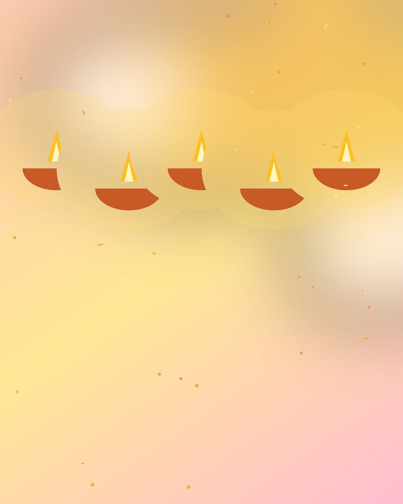

# Wishcraft — Greeting Poster Website

Plain **HTML + CSS + JavaScript**. No frameworks, nothing to install.

---

## 1 · First time: get the real photos (one double-click)

The photos are free **Unsplash** photos (free for personal & commercial use, no credit needed).
The folder already contains stand-in images so the site works immediately — run this once to swap in the real photos:

| Windows | Mac / Linux |
|---|---|
| double-click **`get-real-images.bat`** | double-click **`get-real-images.command`** (or run `bash get-real-images.sh`) |

It reads `images/image-list.txt`, downloads each photo into the right folder and keeps the old image if a download fails.
To change a photo: pick any photo on unsplash.com, copy the ID from the end of its address
(`unsplash.com/photos/pink-roses-oEWdQsbRVZk` → `oEWdQsbRVZk`), paste it into `image-list.txt`, run the script again.
Or simply drop your own `.jpg` into the folder with the same file name.

## 2 · Download works everywhere

Download works from every button (card, preview, editor) on phone, laptop and computer —
including when you simply double-click `index.html`. It shows only **"Poster downloaded ✓"**.

How: browsers won't export pictures made from image files opened from disk, so the downloader uses
ready-made copies of the poster images in `images/data/`. **After you add or replace images in
`images/backgrounds`, `images/photos` or `images/logo`, double-click `update-download-files.bat`**
(Mac: `update-download-files.command`). `get-real-images` already does this for you automatically.
On a real website (hosting) or VS Code Live Server these copies aren't needed at all.

Optional: `start-website.bat` / `start-website.command` run the site at `http://localhost:8080`.

---

## 3 · Edit a poster template (all in the HTML)

Every poster is plain HTML inside its card, in `index.html` (Trending) and `events/birthday.html`.
Find the card by its `data-template="…"` and edit:

```html
<div class="poster" data-name="Happy Diwali" style="--accent:#ffb938">          ← accent colour (decor, glow)
     ← BACKGROUND image
  <div class="poster__overlay" style="--overlay:rgba(40,12,0,0.38)"></div>        ← colour wash (delete = none)

  <figure class="poster__photo" data-shape="circle" data-decor="dots"               ← MAIN IMAGE
          style="--x:50; --y:36; --w:44; --frame:#ffd98a">
    
  </figure>

  <figure class="poster__logo" data-badge style="--x:12; --y:8; --w:10">           ← LOGO
    </figure>

  <div class="poster__text" data-anchor="bottom" style="--x:50; --y:94; --w:86">   ← TEXT BLOCK
    <p class="poster__kicker"  style="--font:'Cormorant Garamond'; --size:4.2; --color:#ffd98a; --align:center">Festival of lights</p>
    <p class="poster__heading" data-effect="glow" style="--font:'Great Vibes'; --size:15; --color:#fff3d6; --align:center">Happy Diwali</p>
    <p class="poster__message" style="…">May the lights …</p>
    <p class="poster__from"    style="…">The Sharma Family</p>
  </div>
</div>
```

| Setting | Meaning |
|---|---|
| `--x`, `--y` | position in % of the poster (photo & logo: their centre) |
| `--w` | width in % of the poster |
| `data-shape` | `circle` `rounded` `arch` `heart` `star` `hexagon` `blob` |
| `data-decor` | `none` `ring` `dots` `blob` `layers` `sparkles` |
| `data-badge` | white rounded badge behind the logo (remove for none) |
| `data-anchor` | text block hangs from its `--y`: `top`, `middle` or `bottom` |
| `data-card` | frosted card behind the text; colour `--card:rgba(…)` |
| per line: `--font` `--size` `--weight` `--style:italic` `--color` `--align` `--spacing` `--case:uppercase` | each text line has its own style |
| `data-effect` on a line | `shadow`, `glow` or `outline` |
| `data-confetti="12"` on `.poster` | adds confetti & sparkles (number = pattern) |
| `--pos` on the background | which part of the photo stays visible (`50% 30%` = higher) |

Hide a line by leaving it empty. Use `<br>` for a forced line break.
The card's name/category under the poster: `data-title` / `data-cat` on the `<article>`.
**Add a template:** copy one whole `<article class="poster-card">…</article>` and change it.
**"Create Greeting" starting design:** `<template id="blankPoster">` near the bottom of each page.

Fonts available: Fraunces, Playfair Display, Cormorant Garamond, Great Vibes, Dancing Script, Pacifico,
Lobster, Caveat, Bebas Neue, Poppins, Plus Jakarta Sans (Google Fonts).

## 4 · What visitors can do

- **Cards** show the full live poster (background, main image in its shape, logo, text).
- **Preview** opens it large with **Download poster** on the preview itself and a **PNG / JPG** switch.
- **Download** on a card saves that poster straight away (PNG, 1080 × 1350).
- **Edit** opens Poster Studio:
  - **Text** — each line (top line, heading, message, name/date) has its own text, font, size, colour,
    alignment, bold / italic / capitals; heading effects; text block Top / Middle / Bottom, left-right,
    up-down, width, frosted card on/off + colour + strength.
  - **Photo** — upload, show/hide, 7 shapes, 6 decoration styles, size, 9-point placement, fine position, frame colour.
  - **Logo** — upload, show/hide, badge, size, 9-point placement, fine position.
  - **Background** — pick any background on the page or upload one, image focus, colour wash, confetti, accent colour.
  - **Download** saves exactly what the preview shows. Changes in the editor are not written back to the HTML.

## 5 · Pages and how they are linked
| Page | File | Its own look | Its own animation |
|---|---|---|---|
| Home | `index.html` | `css/home.css` | `js/home.js` |
| All Events | `events/events.html` | `css/events.css` | `js/events.js` |
| Birthdays | `events/birthday.html` | `css/birthday.css` | `js/birthday.js` |
| Weddings | `events/wedding.html` | `css/wedding.css` | `js/wedding.js` |
| Anniversary | `events/anniversary.html` | `css/anniversary.css` | `js/anniversary.js` |
| Festivals | `events/festivals.html` | `css/festivals.css` | `js/festivals.js` |
| Special Days | `events/special-days.html` | `css/special-days.css` | `js/special-days.js` |

- Every page has the same menu and footer, so all pages link to each other.
- Home page occasion cards open the matching page, already filtered —
  e.g. Diwali opens `events/festivals.html?filter=diwali`. The filter word is the `data-filter` of a chip on that page.
- Each inner page works exactly like the Birthday page: search, filter chips, sort, preview, edit, PNG/JPG download, mobile full-screen preview.
- To change a page's colours open its own css file (the variables at the top). To change the falling shapes (confetti, petals, hearts, sparks, stars) and their colours open its own js file.

## 6 · Contact details (footer)
In every page find `CONTACT DETAILS` in the footer and change the phone number and e-mail:
`<a href="tel:+919876543210">…+91 98765 43210…</a>` and `<a href="mailto:hello@yourwebsite.com">…</a>`.
Use Find & Replace across all files in VS Code (Ctrl + Shift + H) to change all 7 pages at once.

## 7 · Page header background
In any inner page find `EVENT HERO` and change:
`style="--hero-bg: url('../images/backgrounds/birthday-bg.jpg'); --hero-overlay: 0.35; --hero-position: center;"`
If the image file name contains an apostrophe (`'`), write it as `%27` here.

## 8 · Files
```
index.html                 home page
events/*.html              the six inner pages (see table above)
css/style.css              design tokens + components shared by every page
css/poster.css             the poster (shapes, text, logo, photo)
css/editor.css             Poster Studio
css/responsive.css         breakpoints 320 → 1920 px
css/<page>.css             colours + header look of that one page
js/script.js               shared: menu, animations, search, preview
js/poster.js               poster shapes/decor + PNG/JPG download
js/editor.js               Poster Studio
js/event-page.js           shared by inner pages: search / filters / sort / header scene
js/<page>.js               settings of that one page's header animation
images/0 home/, images/1 birthday/, images/backgrounds/   poster + header backgrounds
images/photos/             main photos used inside the shapes
images/events/             occasion cards on the home page
images/logo/, images/icons/
images/image-list.txt      which Unsplash photo goes where
images/data/               download copies of the images (auto-generated)
get-real-images.*          downloads the real photos
update-download-files.*    refreshes images/data/ after you change images
start-website.*            optional local web server
tools/                     helper scripts used by the two above
```
Colours, fonts, radius and shadows for the whole site: CSS variables at the top of `css/style.css`.
